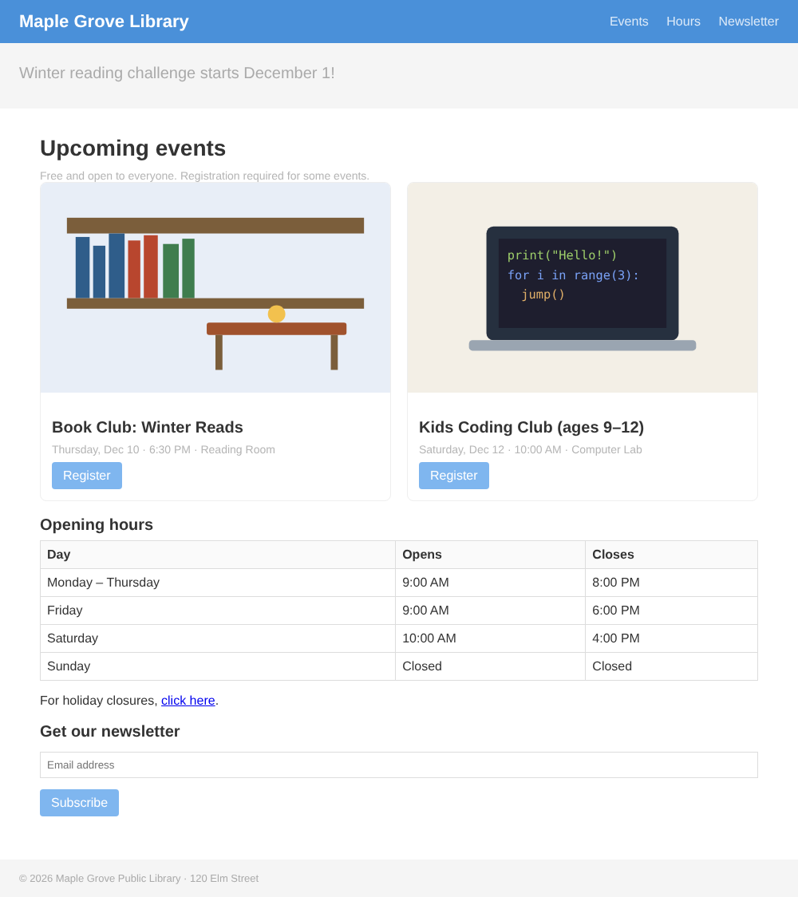
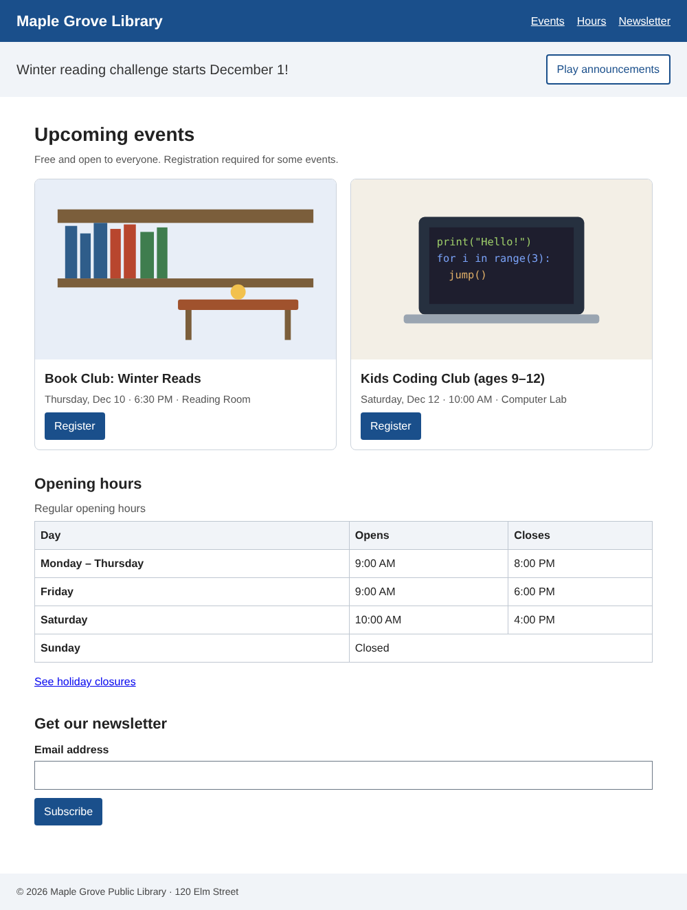
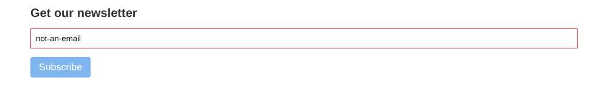
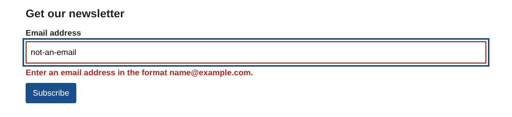

# Accessibility Case Study: Before and After

An audit and remediation of a small public library web page against **WCAG 2.1 Level AA**, the standard behind U.S. **Section 508**.

The [**before**](before/index.html) page looks fine at a glance, but it locks out keyboard users, confuses screen readers, and is hard to read for people with low vision. The [**after**](after/index.html) page looks almost the same and works for everyone.

> The library is fictional. The barriers are common ones found on real sites.

## Results

| | Before | After |
|---|---|---|
| Automated scan (axe-core): rules failed | **7** (21 elements) | **0** |
| Keyboard and behavior checks passed | **0 of 9** | **9 of 9** |
| Barriers found in total (automated + manual) | **15** | **0** |

Automated tools found only **7 of the 15** barriers. The rest, such as an inaccessible dialog, errors shown only by color, and controls that don't work with a keyboard, were found by manual keyboard and screen reader testing. That's why both are needed.

| Before | After |
|---|---|
|  |  |

**Form errors:** before, a thin red border is the only sign something is wrong. After, there's a text message, the field is marked invalid for screen readers, and focus moves to the field.




## Findings and fixes

| # | Barrier | Who it affects | WCAG | Found by | Fix |
|---|---|---|---|---|---|
| 1 | No page language | Screen reader users (wrong pronunciation) | 3.1.1 (A) | axe | `<html lang="en">` |
| 2 | No page title | Everyone, especially screen reader and tab users | 2.4.2 (A) | axe | Descriptive `<title>` |
| 3 | Focus outline removed (`outline: none`) | Keyboard users can't see where they are | 2.4.7 (AA) | Manual | Visible `:focus-visible` outline |
| 4 | Low-contrast text and buttons (11 elements, as low as 2.05:1) | Low vision, bright screens | 1.4.3 (AA) | axe | New colors, all at least 4.5:1 |
| 5 | No way to skip the header | Keyboard and screen reader users | 2.4.1 (A) | Manual | "Skip to main content" link |
| 6 | No landmarks (all `<div>`s) | Screen reader users can't jump between regions | 1.3.1 (A) | axe | `header`, `nav`, `main`, `footer` |
| 7 | Menu items are clickable `<span>`s | Keyboard users can't use the menu at all | 2.1.1 (A), 4.1.2 (A) | Manual | Real links in a `nav` list |
| 8 | Banner rotates every 3 s with no pause | Users with attention or reading difficulties; screen readers | 2.2.2 (A) | Manual | Pause/play button; no rotation with "reduce motion" |
| 9 | Headings are styled `<div>`s | Screen reader users can't skim by heading | 1.3.1 (A), 2.4.6 (AA) | axe (partly) | `h1` and `h2` in order |
| 10 | Images have no alt text | Blind users | 1.1.1 (A) | axe | Descriptive `alt` |
| 11 | "Register" and "Subscribe" are `<div>`s | Keyboard and screen reader users can't activate them | 2.1.1 (A), 4.1.2 (A) | Manual | `<button>`, with hidden text naming the event |
| 12 | Hours table has no header cells | Screen readers read numbers without context | 1.3.1 (A) | Manual | `<caption>`, `<th scope>` |
| 13 | "Click here" link | Screen reader users browsing a links list | 2.4.4 (A) | Manual | "See holiday closures" |
| 14 | Email field: placeholder instead of label; error shown by red border only | Screen reader users; color-blind users | 1.3.1, 3.3.1, 3.3.2 (A), 1.4.1 (A) | Manual | `<label>`, text error linked with `aria-describedby`, `aria-invalid`, focus moved to the field |
| 15 | Registration popup is a styled `<div>` | Focus stays behind it; Escape doesn't work; not announced | 2.4.3 (A), 4.1.2 (A) | Manual | Native `<dialog>` with `showModal()`, focus returned to the opener on close |

Every fix is marked with a `Fix N` comment in [`after/index.html`](after/index.html).

## How I tested

1. **Automated scan** with [axe-core](https://github.com/dequelabs/axe-core), the engine behind many accessibility tools ([`scripts/audit.py`](scripts/audit.py)). Results: [`docs/axe-results.json`](docs/axe-results.json).
2. **Keyboard-only testing:** Tab, Shift+Tab, Enter, Space and Escape through every control, turned into repeatable checks with Playwright ([`scripts/keyboard_test.py`](scripts/keyboard_test.py)). Results: [`docs/keyboard-results.txt`](docs/keyboard-results.txt).
3. **Contrast checks** for every text and button color (axe's color-contrast rule, AA thresholds).
4. **Screen reader review** (NVDA or JAWS on Windows): headings list, landmarks, form labels and errors, and the dialog. See the checklist below.

## Screen reader checklist

| Check | Expected on the after page |
|---|---|
| Open the headings list (NVDA: Insert+F7) | "Upcoming events", both event names, "Opening hours", "Get our newsletter" |
| Tab to a Register button | "Register for Book Club: Winter Reads, button" |
| Activate it | "Register: Book Club: Winter Reads, dialog"; Escape returns to the button |
| Submit a bad email | "Email address, invalid entry, Enter an email address in the format name@example.com" |
| Read the hours table | Each cell announced with its day and column header |

## Run it yourself

Open `before/index.html` and `after/index.html` in a browser, then try using each with only the keyboard.

To rerun the automated checks (requires Node.js and Python 3):

```bash
npm install                       # installs axe-core
pip install playwright
playwright install chromium
python scripts/audit.py           # axe scan of both pages
python scripts/keyboard_test.py   # keyboard checks of both pages
```

## Skills shown

Section 508 / WCAG 2.1 AA auditing · semantic HTML · ARIA (used only where native HTML isn't enough) · accessible forms and dialogs · automated accessibility testing (axe-core, Playwright) · manual testing with keyboard and screen readers

## License

MIT
